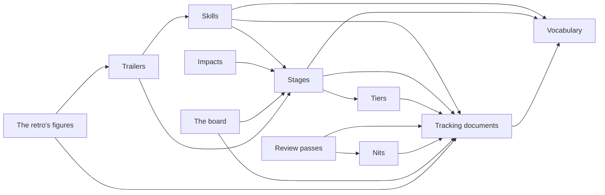

# Features

Every feature a host gets from the `sdlc` plugin and its optional factory (`sdlc-factory`), each
with a one-line definition in the plugin's own words, the file that specifies it, and the features
it depends on. `docs/PROCESS.md` draws the loops these run in. This map is kept by hand and
checked against the code by `tests/test_feature_map.py`: a stage, tier, impact, nit cost or value,
review pass, skill, board column or trailer the code fixes with no entry here fails it. Every
script command and config key is listed with its use by `sdlc.py retro`'s `surface`, not here
(`docs/REFERENCE.md`, *Retrospectives*).

Each entry reads `term`: definition. Specified: the file that says it. Depends on: other entries.

## Vocabulary

- **`change`**: one piece of work with a number and a slug (`NNN-slug`), its folder under `.sdlc/work/`, its branch and its worktree, from `/sdlc:intent` until close or drop. Specified: `guide/process.md`. Depends on: `intent.md`.
- **`seed`**: an entry in the register, tagged `[idea]`, `[bug]` or `[nit]`: a change request no change has taken up yet. Specified: `docs/REFERENCE.md`. Depends on: `inbox.md`.
- **`gate`**: the host's commands a change must pass before it moves on, judged by their exit and never by a person: `[commands] check`, and the slow gate when the diff calls for it, run by `/sdlc:ship`, `sdlc.py gate` and the factory's `gate`. Never a person's yes, which is an approval. Specified: `guide/process.md`. Depends on: nothing.
- **`slow gate`**: `[commands] build`, the second gate, for what needs real services, data or time: run when a changed path matches `commands.build_when`, on a deep review whatever it says, and once at a factory train's tip. Specified: `guide/process.md`. Depends on: `gate`.
- **`WAIT`**: the one step in a writing skill where it stops and asks the person a literal question in a dialog; only a chosen yes lets it write. Specified: `guide/process.md`. Depends on: nothing.
- **`approval`**: a person's yes at a WAIT, the only thing that lets a writing skill write; never a gate, which runs a command. A factory landing's WAIT approves itself only on a batch with no risk signal. Specified: `guide/process.md`. Depends on: `WAIT`.
- **`acceptance checks`**: the commands a change's `checks.md` holds, each proving what only a revert could break, run by `sdlc.py accept` at ship and at a landing; called "acceptance" after a doc's first use and on labels. Never a person's yes, and never the gate. Specified: `docs/REFERENCE.md`. Depends on: `change`.
- **`vet`**: `sdlc.py vet`, which checks each change folder against its tier and stage, the artifacts it owes and their frontmatter, and with `--strict` exits 1 on a problem. It runs no command of the host's, so it is never a gate. Specified: `docs/REFERENCE.md`. Depends on: `change`.
- **`arbiter`**: the factory agent that weighs each round's findings, keeping or dropping each change a reviewer asked for against the code, before the builder reworks; its answers are the round's `verified.md`. Never the approver, which decides the whole change at the end. Specified: `plugins/factory/README.md`. Depends on: `factory`, `finding`.
- **`verification`**: the umbrella for did we build it right: the gates, the reviews, the arbiter and the acceptance checks together. Specified: `guide/review.md`. Depends on: `gate`, `acceptance checks`, `arbiter`, `finding`.
- **`validation`**: did we build the right thing: the milestones and the product's outcomes, which the retro judges. Never a check of the code. Specified: `guide/process.md`. Depends on: `retro`, `direction`, `outcome`.
- **`stop`**: any time a change's session waited on the person: an approval, a question, or an extra reply; counted at close against the approvals the change owed. The metrics' own names for it (the stop kind `gate`, `Sdlc-AfterGate`, the `gate=` count) keep their names. Specified: `scripts/metrics.py`. Depends on: `approval`, `Sdlc-Stage`.
- **`finding`**: one thing a review raised about a change, ranked important, nit or pre-existing, with its evidence and what was done about it. Specified: `templates/findings.md`. Depends on: `findings.md`.
- **`nit`**: a finding approved unfixed, kept in the register with its cost and value, so later changes pay it down. Specified: `guide/process.md`. Depends on: `finding`, `seed`.
- **`impact`**: what a change does to someone holding the previous release, settled at ship; a release takes the highest. Specified: `guide/process.md`. Depends on: `change`.
- **`origin:`**: where a change's finding came from, on its intent: `host`, found using the plugin in another repo, or `self`, found working on this one; never which repo, and unknown with no line. Specified: `scripts/sdlc.py`. Depends on: `intent.md`, `seed`.
- **`landed`**: committed on the base branch: a change's own commit, then its `Close` commit. Specified: `docs/REFERENCE.md`. Depends on: `change`, `Sdlc-Landed`.
- **`retro`**: the outermost loop: a look across every change and release since the last retrospective, ending in one `Retrospective` commit. Specified: `guide/process.md`. Depends on: `change`, `direction`.
- **`direction`**: the doc of goals, milestones and the next major release that the retro keeps. Specified: `templates/direction.md`. Depends on: `outcome`.
- **`outcome`**: a line of the product doc saying what users get, which goals and changes cite and the retro scores. Specified: `defaults/PRODUCT.md`. Depends on: nothing.
- **`drift`**: what a newer plugin changed in a doc setup copied, told apart from what the host changed, so setup can propose a refresh. Specified: `docs/REFERENCE.md`. Depends on: `/sdlc:setup`.
- **`worktree`**: the checkout a change is worked in, at `.claude/worktrees/NNN-slug`, so the main checkout stays clean. Specified: `guide/process.md`. Depends on: `change`.
- **`factory`**: the optional `sdlc-factory` plugin, which builds and reviews a change with agents in rounds and lands a batch as a train. Specified: `plugins/factory/README.md`. Depends on: `change`, `gate`.
- **`parked`**: a factory change waiting on a host resource its check said is held (the base branch's `[park] exit`), with what is held, by whom, its next retry and a deadline the host can't move; past the deadline it stops for the person. Never a red gate, and never a decision to answer. Specified: `plugins/factory/README.md`. Depends on: `factory`, `gate`.

## Skills

- **`/sdlc:intent`**: opens a change: interviews the person, drafts `intent.md`, and creates the change's number, branch and worktree after its WAIT. Specified: `skills/intent/SKILL.md`. Depends on: `intent.md`, `seed`.
- **`/sdlc:spec`**: turns a Tier 2 intent into `spec.md`'s numbered requirements and design. Specified: `skills/spec/SKILL.md`. Depends on: `intent.md`, `spec.md`.
- **`/sdlc:ship`**: runs the gate, reviews the diff in its passes, writes `findings.md`, and commits the change with its folder. Specified: `skills/ship/SKILL.md`. Depends on: `gate`, `findings.md`, `correctness`.
- **`/sdlc:close`**: lands a shipped change on the base branch, mirrors it to the tracker, removes its folder in a `Close` commit with its measured trailers, and cleans up. Specified: `skills/close/SKILL.md`. Depends on: `stage: shipped`, `Sdlc-Totals`.
- **`/sdlc:drop`**: records why a change won't ship and closes it as a `Drop` commit that keeps the base branch's files. Specified: `skills/drop/SKILL.md`. Depends on: `stage: dropped`.
- **`/sdlc:status`**: reports the open changes, what each needs, and the one next action. Read-only. Specified: `skills/status/SKILL.md`. Depends on: `change`.
- **`/sdlc:idea`**: files, edits or retires an idea in the register, committed alone on the base branch. Specified: `skills/idea/SKILL.md`. Depends on: `seed`, `inbox.md`.
- **`/sdlc:bug`**: files, retags or retires a bug in the register, with its severity and the change that introduced it. Specified: `skills/bug/SKILL.md`. Depends on: `seed`, `inbox.md`.
- **`upstream bug`**: a bug in the plugin met in a host, filed by `/sdlc:bug` as a public issue on the plugin's repo (`sdlc.py upstream`), from an allowlist with the host's specifics cut, after the exact body is shown, and once; `/sdlc:triage` reads it as from a host. Specified: `skills/bug/SKILL.md`. Depends on: `/sdlc:bug`, `/sdlc:triage`, `origin:`.
- **`/sdlc:triage`**: reads the issues people filed and proposes a verdict for each: an idea, a bug, an open change's `closes:`, or closed. Specified: `skills/triage/SKILL.md`. Depends on: `seed`, `Sdlc-Triaged`.
- **`/sdlc:health`**: runs the repo's scans and tiers each finding: report, fix inline, or write an intent. Specified: `skills/health/SKILL.md`. Depends on: `/sdlc:intent`.
- **`/sdlc:release`**: proposes a version from the closed changes' impacts, bumps, writes the notes and tags. Specified: `skills/release/SKILL.md`. Depends on: `impact`, `landed`.
- **`/sdlc:publish`**: pushes the release and its tag, then runs the host's publish command. Specified: `skills/publish/SKILL.md`. Depends on: `/sdlc:release`.
- **`/sdlc:retro`**: runs the retrospective's passes over history and commits the direction doc, the register and its report. Specified: `skills/retro/SKILL.md`. Depends on: `retro`, `surface`.
- **`/sdlc:setup`**: sets a repo up for the plugin, or refreshes what an update changed under it. Specified: `skills/setup/SKILL.md`. Depends on: `drift`, `process doc`.
- **`/sdlc:uninstall`**: takes setup's files and lines back out of a repo. Specified: `skills/uninstall/SKILL.md`. Depends on: `/sdlc:setup`.
- **`/sdlc:update`**: prints the steps that take a newer release in this repo (`sdlc.py update`), and runs its `claude plugin update` commands after its WAIT. Specified: `skills/update/SKILL.md`. Depends on: `/sdlc:setup`, `the update check`.
- **`the update check`**: the plugin's one hook, at a session's start: it prints one line when a newer release is out (`sdlc.py update --hook`), else when this repo's setup has something to draft, checks at most once a day, and only advises. `/sdlc:status` repeats the line. Specified: `hooks/hooks.json`. Depends on: `/sdlc:status`.
- **`/sdlc:dashboard`**: opens the board in a browser. Specified: `skills/dashboard/SKILL.md`. Depends on: `Planned`.
- **`/sdlc-factory:spec`**: has the factory's spec-writer draft a Tier 2 spec, shown and written after one approval. Specified: `plugins/factory/skills/spec/SKILL.md`. Depends on: `spec.md`, `factory`.
- **`/sdlc-factory:build`**: adds a change to the supervisor: the builder plans and builds it, reviewers check it in rounds, and an approver decides. Specified: `plugins/factory/skills/build/SKILL.md`. Depends on: `plan.md`, `decisions.md`, `factory`.
- **`/sdlc-factory:decide`**: walks the person through a change's open decisions and records their answers. Specified: `plugins/factory/skills/decide/SKILL.md`. Depends on: `decisions.md`.
- **`/sdlc-factory:land`**: lands a batch of ready changes as one train: each shipped and closed in order, the gate run at the tip. Specified: `plugins/factory/skills/land/SKILL.md`. Depends on: `/sdlc:ship`, `/sdlc:close`, `Sdlc-Landed`.
- **`/sdlc-factory:autopilot`**: runs the factory from seed to landing while the person is away, behind one approval of the run's goal (from the direction doc, a register theme, or the person's own) and bounds: it plans the register's seeds toward that goal, leaving one already fixed or wrong for the person, opens those it takes, builds each once what it depends on has landed, answers escalated calls on their defaults as its own, holds what touches a guard or a contract, and lands the rest in batches, until a budget, the dollar cap or the hours run out, then writes a summary to review. Specified: `plugins/factory/skills/autopilot/SKILL.md`. Depends on: `/sdlc-factory:build`, `/sdlc-factory:land`, `Sdlc-Landed`, `decisions.md`.
- **`/sdlc-factory:eval`**: replays the factory's reviewers on the diffs that let real bugs through, and scores which would have caught each. Specified: `plugins/factory/skills/eval/SKILL.md`. Depends on: `seed`, `factory`.
- **`/sdlc-factory:review`**: reviews code no change touches and proposes what it finds as bugs. Specified: `plugins/factory/skills/review/SKILL.md`. Depends on: `seed`, `factory`.

## Stages

- **`stage: plan`**: an intent is written; nothing designed or built yet. Specified: `guide/process.md`. Depends on: `intent.md`.
- **`stage: spike`**: exploration meant to be thrown away, entered from any stage and left by setting the stage it left; owes nothing. Specified: `scripts/sdlc.py`. Depends on: `change`.
- **`stage: design`**: a Tier 2's spec is being written. Specified: `guide/process.md`. Depends on: `spec.md`.
- **`stage: build`**: the code is being written, to `plan.md` for a Tier 2. Specified: `guide/process.md`. Depends on: `plan.md`.
- **`stage: test`**: built; the gate and the acceptance checks are run, and a factory run waits here for its landing. Specified: `guide/process.md`. Depends on: `gate`.
- **`stage: ship`**: reviewed and being committed by `/sdlc:ship`. Specified: `guide/process.md`. Depends on: `/sdlc:ship`.
- **`stage: shipped`**: committed on its branch, ready for close. Specified: `scripts/sdlc.py`. Depends on: `/sdlc:ship`.
- **`stage: dropped`**: won't ship; the reason is in its intent. Specified: `scripts/sdlc.py`. Depends on: `/sdlc:drop`.

## Tiers

- **`Tier 0`**: trivial: a typo or a one-line fix; no folder, committed directly. Specified: `guide/process.md`. Depends on: nothing.
- **`Tier 1`**: small: `intent.md` alone, its Approach standing in for spec and plan. Specified: `guide/process.md`. Depends on: `intent.md`.
- **`Tier 2`**: substantial: `intent.md`, `spec.md` and `plan.md`, for anything a live consumer or an invariant is near. Specified: `guide/process.md`. Depends on: `intent.md`, `spec.md`, `plan.md`.

## Impacts

- **`impact: major`**: someone holding the previous release has to change what they do. Specified: `guide/process.md`. Depends on: `impact`.
- **`impact: minor`**: they can do something new. Specified: `guide/process.md`. Depends on: `impact`.
- **`impact: patch`**: they do the same things, working or described better. Specified: `guide/process.md`. Depends on: `impact`.
- **`impact: none`**: they receive nothing different. Specified: `guide/process.md`. Depends on: `impact`.

## Nits

- **`Cost: S`**: one sitting and a few lines. Specified: `guide/process.md`. Depends on: `nit`.
- **`Cost: M`**: a test or several files. Specified: `guide/process.md`. Depends on: `nit`.
- **`Value: med`**: a user or host could hit it on an edge case. Specified: `guide/process.md`. Depends on: `nit`.
- **`Value: low`**: only a reader of the code notices. Specified: `guide/process.md`. Depends on: `nit`.

## Review passes

- **`correctness`**: does the change do what its intent or spec's requirements said. Specified: `guide/review.md`. Depends on: `finding`.
- **`contract`**: does it stay inside the invariants the policy doc names. Specified: `guide/review.md`. Depends on: `finding`.
- **`cost`**: could it be simpler, reuse more, or cost less to run. Specified: `guide/review.md`. Depends on: `finding`.
- **`context`**: do the docs that give a session its context still say what the code does. Specified: `docs/REFERENCE.md`. Depends on: `finding`.
- **`ship-security`**: ship's security agent, on a diff that reaches a risky path. Specified: `agents/security.md`. Depends on: `finding`.
- **`ship-behaviour`**: ship's own run of the change's behaviour, each command behind the person's prompt. Specified: `skills/ship/SKILL.md`. Depends on: `finding`.
- **`ship-ui`**: ship's UI agent, on a diff with screens. Specified: `agents/ui.md`. Depends on: `finding`.
- **`ship-ux`**: ship's UX agent, on the same diffs. Specified: `agents/ux.md`. Depends on: `finding`.

## The board

- **`Planned`**: an intent, nothing built. Specified: `scripts/board.html`. Depends on: `stage: plan`.
- **`Designing`**: a Tier 2's spec being written. Specified: `scripts/board.html`. Depends on: `stage: design`.
- **`Building`**: code, by hand or in a factory's rounds. Specified: `scripts/board.html`. Depends on: `stage: build`.
- **`Ready`**: built and checked, not yet committed. Specified: `scripts/board.html`. Depends on: `stage: test`.
- **`Landing`**: committed, on its way to the base branch. Specified: `scripts/board.html`. Depends on: `stage: shipped`.
- **`Needs you`**: a change waiting on the person, each card saying for what. Specified: `scripts/board.html`. Depends on: `WAIT`.
- **`card`**: one change in its column: tier, stage, next command and what it needs. Specified: `scripts/board.py`. Depends on: `change`.
- **`step track`**: a factory run's round as a row of its steps, the current one timed. Specified: `scripts/board.html`. Depends on: `factory`.
- **`drawer`**: the panel a card opens, showing every file in the change's folder. Specified: `scripts/board.html`. Depends on: `card`.

## Tracking documents

- **`intent.md`**: why a change is worth making, in its originator's words; every tiered change has one. Specified: `templates/intent.md`. Depends on: nothing.
- **`spec.md`**: a Tier 2's numbered testable requirements and design. Specified: `templates/spec.md`. Depends on: `intent.md`.
- **`plan.md`**: a Tier 2's files, work order, tests and rollback, written after reading the code. Specified: `templates/plan.md`. Depends on: `spec.md`.
- **`notes.md`**: free-form notes; an unticked line is left undone, and ship carries or drops each. Specified: `templates/notes.md`. Depends on: `change`.
- **`findings.md`**: what ship's review found and what was done about each. Specified: `templates/findings.md`. Depends on: `finding`.
- **`checks.md`**: a change's acceptance checks, each a block ship reruns before it commits. Specified: `templates/checks.md`. Depends on: `change`.
- **`decisions.md`**: a factory change's ledger of decisions, blocking and assumed, and the person's answers. Specified: `plugins/factory/README.md`. Depends on: `factory`.
- **`inbox.md`**: the register: every seed, ranked, committed alone on the base branch. Specified: `templates/inbox.md`. Depends on: `seed`.
- **`process doc`**: the host's answers to the process guide: its tiers, stages and gates. Specified: `guide/process.md`. Depends on: nothing.
- **`review doc`**: the host's answers to the review guide: its passes and what they look for. Specified: `guide/review.md`. Depends on: nothing.
- **`direction doc`**: the goals, milestones and next major release the retro keeps. Specified: `templates/direction.md`. Depends on: `direction`.
- **`product doc`**: the product's outcomes and the evidence the retro scores them by. Specified: `defaults/PRODUCT.md`. Depends on: `outcome`.

## Trailers

- **`Sdlc-Mode`**: how the change was run: by hand or by the factory. Specified: `scripts/metrics.py`. Depends on: `change`.
- **`Sdlc-Coverage`**: what close measured from, and why a part is missing. Specified: `scripts/metrics.py`. Depends on: `change`.
- **`Sdlc-Totals`**: the change's clocks, stops, tokens, prompts, words and tool calls. Specified: `scripts/metrics.py`. Depends on: `stop`.
- **`Sdlc-Stage`**: the same per stage, with its approvals (the trailer's `gate=` count, which keeps its name) and replies. Specified: `scripts/metrics.py`. Depends on: `stage: build`.
- **`Sdlc-Role`**: each agent role's runs, time, tokens, model and behaviour counts. Specified: `scripts/metrics.py`. Depends on: `factory`.
- **`Sdlc-Calls`**: each role's tool calls by name. Specified: `scripts/metrics.py`. Depends on: `Sdlc-Role`.
- **`Sdlc-Prompt`**: each tool prompt the person answered. Specified: `scripts/metrics.py`. Depends on: `stop`.
- **`Sdlc-Tool`**: each tool call by name, a plugin script's by its command, and its errors. Specified: `scripts/metrics.py`. Depends on: `change`.
- **`Sdlc-Skill`**: each plugin skill the change's sessions ran, and how many times. Specified: `scripts/metrics.py`. Depends on: `/sdlc:intent`.
- **`Sdlc-Extra`**: the extra stops per stage, by why each happened. Specified: `scripts/metrics.py`. Depends on: `stop`.
- **`Sdlc-AfterGate`**: the stops typed after a skill's WAIT was answered, its approval given, by skill; the key keeps its name. Specified: `scripts/metrics.py`. Depends on: `WAIT`, `approval`.
- **`Sdlc-Blocked`**: the time spent waiting on a change this one depends on. Specified: `scripts/metrics.py`. Depends on: `change`.
- **`Sdlc-Lead`**: lead time from opened to close, and where it went. Specified: `scripts/metrics.py`. Depends on: `change`.
- **`Sdlc-Runtime`**: the Claude Code versions, models and plugin version the change ran on. Specified: `scripts/metrics.py`. Depends on: `change`.
- **`Sdlc-Rework`**: rework within the change: stages re-entered, revises, failed checks, a factory run's rounds and decisions. Specified: `scripts/metrics.py`. Depends on: `Sdlc-Stage`.
- **`Sdlc-Review`**: what each review round found and how it was dealt with. Specified: `scripts/metrics.py`. Depends on: `finding`.
- **`Sdlc-Happy`**: which stages the change passed straight through. Specified: `scripts/metrics.py`. Depends on: `Sdlc-Stage`.
- **`Sdlc-Spike`**: a spike's time, kept apart from rework. Specified: `scripts/metrics.py`. Depends on: `stage: spike`.
- **`Sdlc-Base`**: where the change's branch started, so its size is all of its commits. Specified: `scripts/sdlc.py`. Depends on: `change`.
- **`Sdlc-Findings`**: ship's findings by rank and disposition, on the change's own commit. Specified: `scripts/sdlc.py`. Depends on: `findings.md`.
- **`Sdlc-Landed`**: who gave a factory landing its approval: the person, the WAIT itself (`by=auto`, which keeps its name), or the factory's autopilot (`by=autopilot`), three values never read as one another. Specified: `plugins/factory/README.md`. Depends on: `/sdlc-factory:land`, `/sdlc-factory:autopilot`.
- **`Sdlc-Fixes`**: each bug a change's `fixes:` names, with its severity, when it was reported and the change that introduced it. Specified: `scripts/closing.py`. Depends on: `seed`.
- **`Sdlc-Origin`**: where the change's finding came from, `host` or `self`, from its intent's `origin:`; none when it named none. Specified: `scripts/closing.py`. Depends on: `origin:`.
- **`Sdlc-Retired`**: a bug retired from the register without a fix, with its severity and the reason. Specified: `scripts/sdlc.py`. Depends on: `/sdlc:bug`.
- **`Sdlc-Triaged`**: an issue's triage verdict, on the register commit that recorded it. Specified: `scripts/sdlc.py`. Depends on: `/sdlc:triage`.

## The retro's figures

- **`surface`**: every skill, script command and config key, built from the code, with its use in the window. Specified: `scripts/retro.py`. Depends on: `Sdlc-Skill`, `Sdlc-Tool`.
- **`share used`**: the items used over those used or unused, per kind; an unmeasured item is in neither. Specified: `docs/REFERENCE.md`. Depends on: `surface`.
- **`retire candidate`**: an item unused in each of the last windows that measured it. Specified: `docs/REFERENCE.md`. Depends on: `surface`, `retro`.
- **`footprint`**: what setup left in a host: the files it created, the keys set, and the lines under `.sdlc/`. Specified: `docs/REFERENCE.md`. Depends on: `/sdlc:setup`.
- **`growth`**: the surface's size at each release, in the plugin's own repo. Specified: `docs/REFERENCE.md`. Depends on: `surface`.
- **`rework`**: what a later change declares it reworks of an earlier one. Specified: `docs/REFERENCE.md`. Depends on: `change`.
- **`hosts`**: the counts from the host repos listed in the plugin's own repo's gitignored `.sdlc/hosts.local` (changes closed and dropped, by way and tier, stops and time, escapes, version lag, the plugin's names they use), never a host's name or path and never pooled with this repo's; `unmeasured` with no list and in every other repo; `sdlc.py hosts` shows the paths, to the terminal alone. Specified: `scripts/retro.py`. Depends on: `retro`, `Sdlc-Mode`, `Sdlc-Totals`.
- **`origins`**: the window's closed changes by their `origin:`, `host`, `self` or `unknown`, the host-found ones read as evidence from another repo. Specified: `scripts/retro.py`. Depends on: `origin:`.
- **`lead time`**: how long changes took from opened to close, by part. Specified: `docs/REFERENCE.md`. Depends on: `Sdlc-Lead`.
- **`stops`**: the window's stops against the gates its changes owed. Specified: `docs/REFERENCE.md`. Depends on: `Sdlc-Totals`.
- **`prose`**: each skill's size, what every session that runs it reads. Specified: `scripts/retro.py`. Depends on: `/sdlc:retro`.
- **`insights`**: the report's answers to the synthesis questions, one per pillar from `guide/insights.md` and any the host's `docs.insights` adds, each from that pillar's figures alone (`sdlc.py retro --insights`), in the one shape `retro-commit` reads. Specified: `guide/insights.md`. Depends on: `retro`, `sdlc:insight`.
- **`sdlc:insight`**: the read-only agent `/sdlc:retro` spawns once per synthesis question, given that question's figures and nothing of the session's reasoning. Specified: `agents/insight.md`. Depends on: `/sdlc:retro`.
