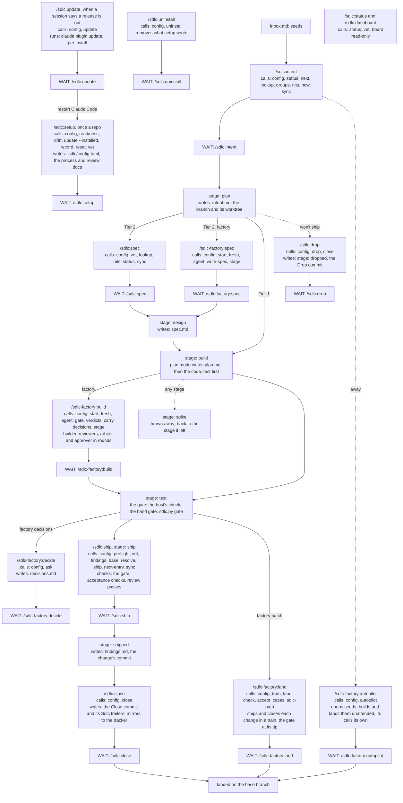
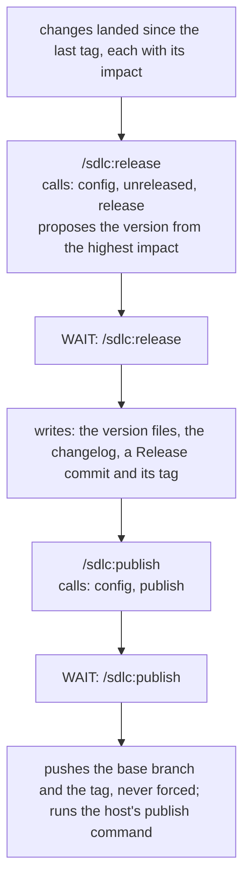
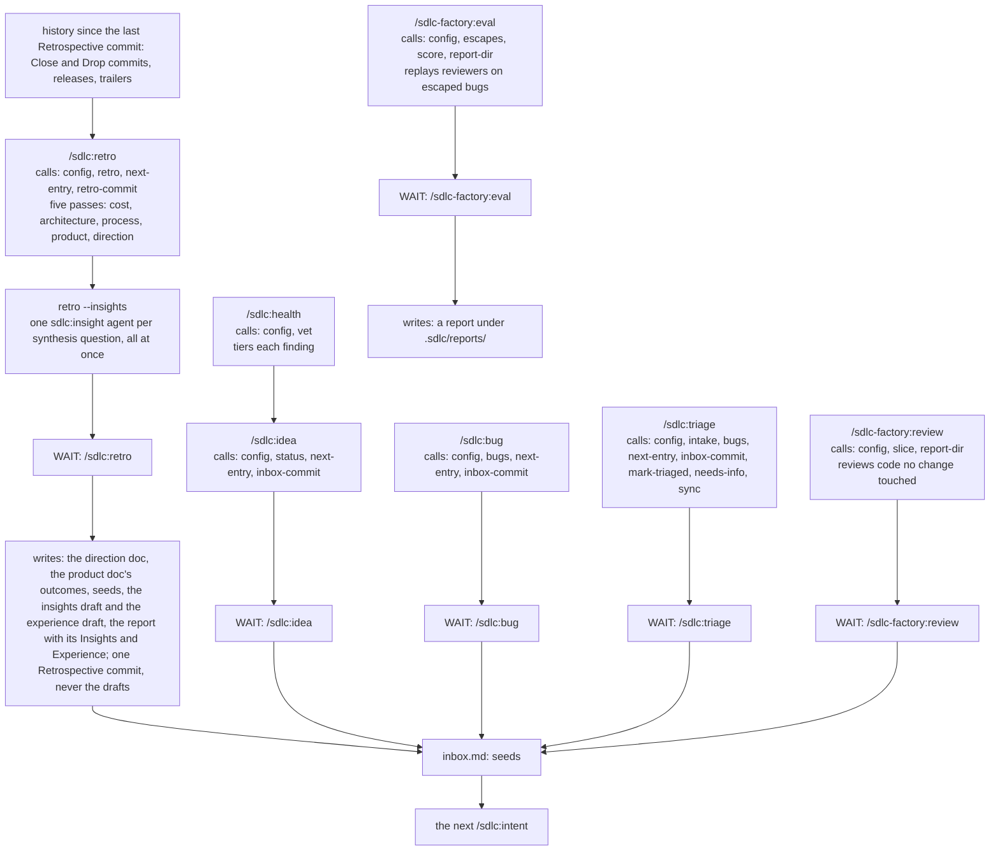

# Process

The plugin's three loops as maps, in `docs/FEATURES.md`'s terms: the **change loop** that takes one
change from a seed to the base branch, the **release loop** that takes landed changes to users,
and the **retro loop** that looks across both and sets what comes next. Each stage shows its
skill, the `sdlc.py` (or `factory.py`) commands the skill runs, what it checks, and what it writes.
A `WAIT:` node is the skill's one approval: nothing it writes is written before the person's
yes. `guide/process.md` says why each step is there; `tests/test_feature_map.py` fails when a
skill, a stage or a WAIT is missing from these maps.

## The change loop

A Tier 1 change skips design; a Tier 0 change has no folder and is committed directly. Either way
of building, by hand or by the factory, ends at the same ship and close. `/sdlc:status` and
`/sdlc:dashboard` read every open change at any point and write nothing.

## The release loop

`/sdlc:status` says a release is due from the changes closed since the last tag. The two WAITs
keep what can be undone (the tag) apart from what can't (the push).

## The retro loop

What the change and release loops leave in history comes back as seeds. The retrospective is due
after two releases or one major; the skills that file seeds run whenever something is found.

